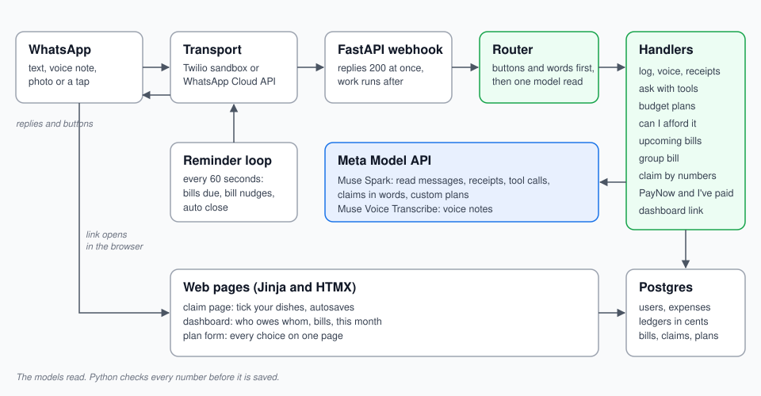

# SplitLedger

**Your money, in the chat you already use.**

SplitLedger is a WhatsApp bot that does two jobs. First, it tracks your own spending: you log by text, voice note or receipt photo, then ask questions about it, set a budget plan and check whether you can afford something. Second, it splits group bills. Snap the receipt with the caption `split` and forward one message. Each friend replies with the numbers of the dishes they had. When everyone is in, the bill closes itself and everyone is told what they owe, with a PayNow
number and QR to pay it and an I've paid button. Simple things stay in the chat. Anything with a list (ticking dishes, the dashboard, the plan form) opens on a web page from a link.

Built for the Meta Global AI Developer Hackathon (Indie track)



## Try it in 30 seconds

| You send | You get |
| --- | --- |
| `coffee 2.20` | ✅ Logged SGD 2.20 · Dining, what is left in your plan, an Undo button |
| a voice note "grab to office twelve eighty" | Logged SGD 12.80 · Transport |
| a receipt photo | items and total, Save or Cancel |
| a receipt photo with caption `split` | a bill code and one message to forward to friends |
| tap **Fix the items** if a line is misread | a page to fix names and prices, then a fresh message to forward |
| friend: taps the link, sends `CLAIM K7Q2AB`, replies `2, 6` | their share so far, a dish picked by two is shared |
| friend, once the bill closes: pays by PayNow, taps **I've paid** | you are told, and can tap Not received if it never arrives |
| `how much did I spend on food this month?` | a total and the top items, from the database |
| `can I afford a 300 hotel?` | spent, still due, really left, a rule of thumb |
| `menu` | every action as a tap choice, including My dashboard and Main currency |
| `currency JPY` | your main currency changes; it starts as your phone's country currency |
| tap **My dashboard** under Bill closed, You owe or Plan saved | your dashboard, signed in for 30 days, can be added to the home screen |

## Which Meta model does what

| Job | Model | Guard in our code |
| --- | --- | --- |
| Read any message: intent and expense | Muse Spark, JSON schema | 8 s timeout, keyword fallback |
| Receipt photo to items | Muse Spark vision | items must add up to the total |
| Voice note to text | Muse Voice Transcribe | goes through the same reader |
| Answer spending questions | Muse Spark tool calls | numbers come from SQL tools, 4 rounds max |
| "Anna and Ben shared the calamari" | Muse Spark, JSON schema | shown back with Looks right or Change first |
| Describe your own budget plan | Muse Spark, JSON schema | shares must total 100 |

The models read. Python checks every number. Money is stored in integer cents and every
bill split adds up to the cent.

## Run it locally

You need Docker, [uv](https://docs.astral.sh/uv/), ffmpeg (for voice notes) and a Meta Model API key.

```bash
git clone <this repo> && cd SplitLedger
cp .env.example .env        # set META_API_KEY and LLM_MODEL
make setup                  # install packages and git hooks
make dev                    # start postgres, run migrations, serve on :8000
open http://localhost:8000/dev/chat
```

`/dev/chat` is a WhatsApp-style simulator, so no phone is needed. To use real WhatsApp, follow
[docs/DEPLOY.md](docs/DEPLOY.md) (Render plus the Twilio sandbox, about 15 minutes).

Other commands:

- `make check`: lint, strict types, tests
- `make seed-dev PHONE=6581234567`: a month of sample history

## How the code is laid out

| Folder | What lives there |
| --- | --- |
| `channels/` | WhatsApp Cloud API, Twilio sandbox and the dev simulator, behind one Transport |
| `handlers/` | the router and one handler per job: log, ask, plan, bills, group bill, claim |
| `llm/` | the Meta Model API client, prompts and response schemas |
| `split/` | splitting money, claims, closing a bill into ledgers, dashboard, exchange rates |
| `pay/` | the EMVCo QR encoder and pay rails, PayNow in the Singapore pack |
| `plans/` | budget frameworks, quotas, affordability rules, upcoming bills |
| `web/` | the claim page, dashboard and plan form (Jinja and HTMX) |
| `jobs/` | the reminder loop: due bills and bill nudges |

Region specific bits (Singapore words like kopi and MRT, MAS loan rules, PayNow) live in
`*_sg.py` packs picked by each user's phone number: +65 gets the Singapore pack, PayNow
included. The number also sets the starting currency and timezone. `LOCALE` is the pack for
numbers with no pack of their own. The core works in any currency.

### Scalability

- **Fast webhook:** it checks the message, stores its id and replies 200 at once. The model
  calls and database work run after the reply, so WhatsApp never waits.
- **Postgres holds the state:** users, ledgers, bills and claims live there, indexed on phone
  number and bill code. Money is stored in integer cents.
- **Slow calls are bounded:** each model call has a timeout (8 s to read a message, 25 s to
  answer a question). Exchange rates are cached for 12 hours and shared by every user.
- **Today it runs as one instance.** A few short-lived drafts (a receipt waiting for Save, a
  plan being set, which bill you are claiming) are kept in memory. To run several instances,
  move those to Postgres or Redis, and run the reminder loop as one separate worker.

### Availability

- **Hosting:** Render keeps the service always on. It health-checks `/healthz`, restarts on
  failure, runs migrations on every start and deploys on every push.
- **No double logging:** WhatsApp and Twilio retry webhooks. Each message id is stored once, so
  a retry never logs an expense twice.
- **No double charging:** closing a bill locks its row and is safe to repeat, so two closes at
  the same moment post each share once. Nudges are recorded, so they are never sent twice.
- **Fallbacks:**
  - If the model is slow or down, keyword rules still log "coffee 2.20".
  - If one exchange rate source fails, the next of the three is tried, and the last good rates
    are kept.
- **Limits:** Render's free Postgres has no backups and expires after 30 days. That covers
  judging, but production needs a paid database with backups.

### Security

- **Signed webhooks:** Meta's `X-Hub-Signature-256` and Twilio's signature are checked with a
  constant-time compare. Anything else gets a 403.
- **Signed, expiring links:** web pages open from HMAC-signed links. A dashboard link lasts
  15 minutes. A bill link lasts 14 days and works for that bill only.
- **Session cookies:** after the link opens, a cookie keeps you signed in. It is `HttpOnly` and
  `SameSite=Lax`, and `Secure` when served over https.
- **No strangers on a bill:** to join a bill you must have a WhatsApp number linked to
  SplitLedger. Nobody can type a name in, and every page shows only the signed-in person's
  data.
- **The model never touches money directly:**
  - Its replies must match a JSON schema, and Python checks every number before saving.
  - Its spending tools are fixed queries limited to the asking user. It never writes SQL.
- **Secrets:** they live only in environment variables (Render secrets, a gitignored `.env`).
  The exchange rate key is never logged.
- **Little personal data:** a phone number, a WhatsApp name and expenses. No bank logins and no
  card numbers.

## Known limits

- **No group bot.** WhatsApp has no API for bots in group chats, so the payer forwards one
  message and each friend talks to the bot one to one.
- **24 hour window.** The bot can only message someone within 24 hours of their last message.
  Reminders outside that window need a Meta approved template, which waits on business
  verification.
- **Test numbers only.** The Twilio sandbox only reaches phones that have joined it.
- **Payments are not checked with a bank.** I've paid is the friend's word; the person paid
  can tap Not received to undo it.
- **Not financial advice.** Affordability answers are rules of thumb with the numbers shown.

## Roadmap

| Next | What it adds |
| --- | --- |
| Weekly summary | A Sunday message with the week's spending against the plan |
| Payment screenshots | Share a GPay or bank confirmation and it logs like a receipt |
| Google Wallet budget card | A pass showing what is left this week, refreshed after every log |
| More region packs | India (UPI), Malaysia (DuitNow), Thailand (PromptPay), Brazil (Pix), on the same QR encoder |
| Auto-import | Spending appears without typing, through bank open-banking APIs |
